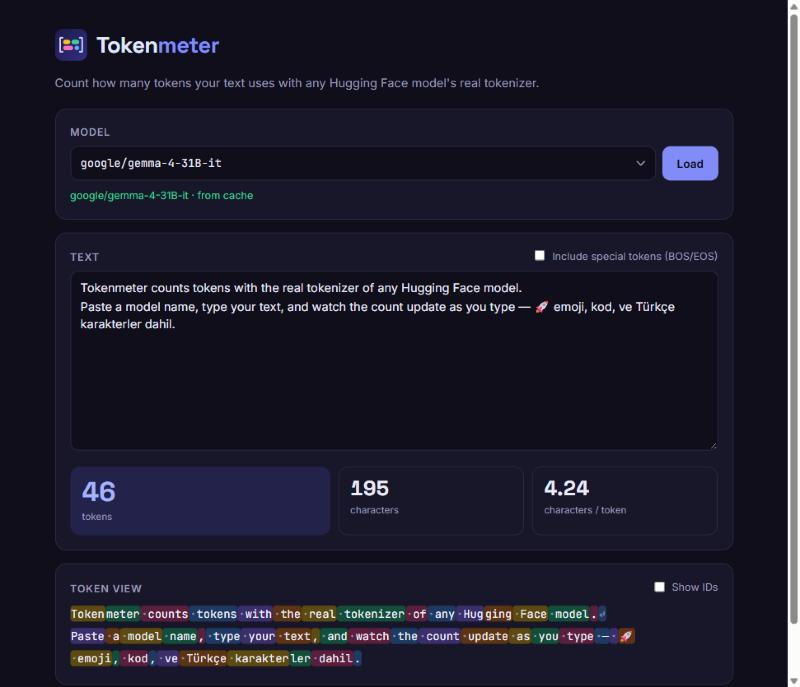

<p align="center">
  <a href="https://ardasdasdas.github.io/tokenmeter/">
    <picture>
      <source media="(prefers-color-scheme: dark)" srcset="app/static/logo-dark.svg">
      
    </picture>
  </a>
</p>

<p align="center">
  <strong>Count how many tokens your text uses — with any Hugging Face model's real tokenizer.</strong>
</p>

<p align="center">
  <a href="https://ardasdasdas.github.io/tokenmeter/"></a>
  <a href="https://github.com/ardasdasdas/tokenmeter/actions/workflows/pages.yml"></a>
  <a href="LICENSE"></a>
</p>

<p align="center">
  
</p>

---

Paste a model name such as `google/gemma-4-31B-it` (or its `huggingface.co/...` link), type
your text, and Tokenmeter tells you exactly how many tokens it is **for that model** — not an
estimate. It downloads the model's `tokenizer.json` once, caches it, and counts as you type.

## Features

- **Exact counts** — uses the model's own `tokenizer.json`, so the number matches what the model sees.
- **Cached tokenizers** — each `tokenizer.json` is downloaded once; switching back to a model is instant.
- **Searchable model picker** — your cached models in a dropdown, plus **New** to load any other model.
- **Live token view** — every token highlighted in color, with optional token IDs.
- **Special tokens toggle** — include or leave out BOS/EOS tokens.
- **Two ways to run** — in the browser (GitHub Pages) or with a local Python server.

## Use it online

**→ [ardasdasdas.github.io/tokenmeter](https://ardasdasdas.github.io/tokenmeter/)**

The hosted version runs entirely in your browser. `tokenizer.json` is fetched straight from
Hugging Face and kept in your browser's cache; your text never leaves your machine.
Gated models (e.g. `meta-llama/*`) need an access token, so use the local server for those.

## VS Code extension

Tokenmeter is also a VS Code extension: a live token count in the status bar, 50 popular models built in for offline use, and a warning threshold for prompt writing.
See [vscode-extension/README.md](vscode-extension/README.md), or download the `.vsix` from [Releases](https://github.com/ardasdasdas/tokenmeter/releases).

## Run locally

Requires Python 3.10+.

```bash
git clone https://github.com/ardasdasdas/tokenmeter.git
cd tokenmeter
python -m venv .venv
.venv/Scripts/pip install -r requirements.txt      # macOS/Linux: .venv/bin/pip
.venv/Scripts/python -m uvicorn app.main:app --port 8765
```

Then open <http://localhost:8765>. The local server counts with the official Rust-backed
[`tokenizers`](https://github.com/huggingface/tokenizers) library and caches files in `.cache/`.

### Gated and private models

Copy `.env.example` to `.env`, set `HF_TOKEN` to a
[Hugging Face access token](https://huggingface.co/settings/tokens), and accept the license on
the model's page. The token stays on the server and is never sent to the browser.

## How it works

| | Browser (GitHub Pages) | Local server |
|---|---|---|
| Tokenizer | [`@huggingface/tokenizers`](https://www.npmjs.com/package/@huggingface/tokenizers) (JS) | [`tokenizers`](https://pypi.org/project/tokenizers/) (Python/Rust) |
| Cache | Browser Cache Storage | `.cache/` folder + memory |
| Gated models | — | ✓ with `HF_TOKEN` |

The page picks the mode automatically: if it finds the local API it uses it, otherwise it
tokenizes in the browser. Both produce identical token IDs (add `?mode=browser` to the URL to
force browser mode locally).

Notes:

- Raw text is counted; no chat template is applied.
- Only repositories that ship a `tokenizer.json` are supported.

## API (local server)

| Endpoint | Description |
|---|---|
| `POST /api/tokenize` | `{"model": "...", "text": "...", "add_special_tokens": false}` → `token_count`, `char_count`, `tokens`, `ids`, `cached` |
| `GET /api/cache` | Models in the cache |
| `DELETE /api/cache/{owner}/{model}` | Remove a model from the cache |

## Development

```bash
.venv/Scripts/python -m pytest -q
```

The static site lives in [`app/static`](app/static) and is deployed to GitHub Pages by
[`.github/workflows/pages.yml`](.github/workflows/pages.yml) on every push to `main`.

## License

[MIT](LICENSE) © 2026 Arda Uslu
